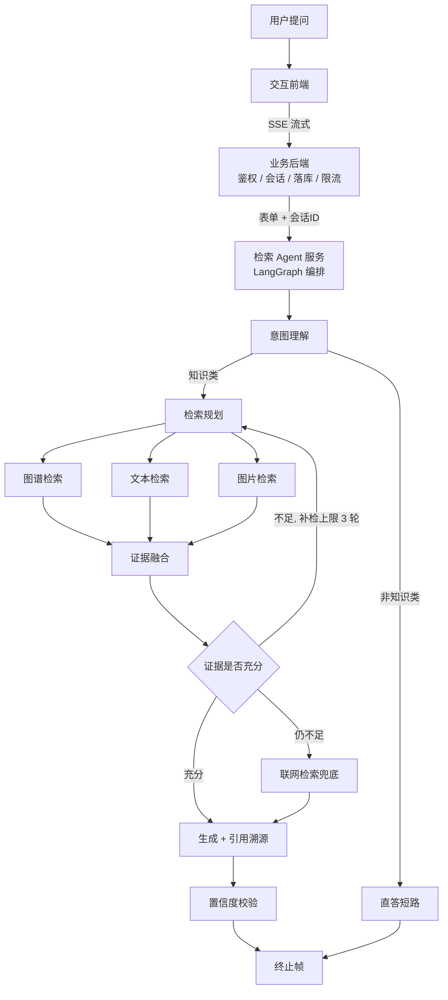
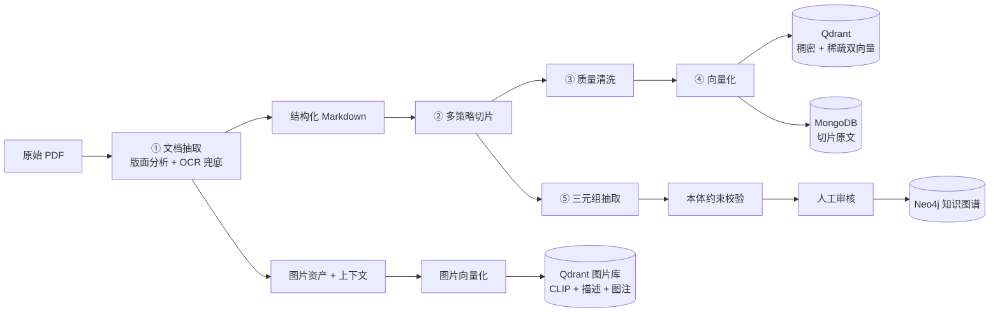

# 工业领域知识问答 Agent

> 面向生产工艺的企业级知识问答系统。覆盖**工艺文档、知识图谱、图片资产**三类异构知识源，
> 解决工业领域专业术语密集、单一向量检索命中率低的问题。
>
> **技术栈**：Python · FastAPI · LangGraph · Qdrant · Neo4j · MongoDB · BGE-M3 · SSE · React

---

## 一、要解决什么问题

工业场景的问答和通用场景很不一样，有三个硬约束：

1. **术语密度高**。"阳极效应""母线提升""预焙阳极"这类词，通用 embedding 模型区分度差；
   而"电解槽"和"铝电解槽"是同一个东西，字面却差一半 —— 纯向量检索两头都不讨好。
2. **答案必须可溯源**。生产工艺问答影响现场操作，答案必须能点开看证据原文，不能是"模型说"。
3. **等待时间长**。一次检索要跑图谱 + 文本 + 图片三路，加上大模型生成，
   用户干等十几秒到一分钟是完全不能接受的。

整个系统的设计都是围绕这三条展开的。

---

## 二、整体架构

### 在线链路（检索与生成）



### 离线建库流水线



---

## 三、关键设计

### 1. 离线建库：把 PDF 变成可检索的三类资产

**① 文档抽取。** 用版面分析模型做整本 PDF 的结构化还原，**整本失败时自动回落到整页 OCR**，
保证不因为个别页面版式异常丢掉整本书。产物是结构化 Markdown，同时把书里的图片
切出来单独存，并记录每张图**在正文中的上下文**（前后文、页码、坐标），供后续检索时还原语义。

**② 多策略切片。** 不是一种切法打天下，而是三类策略并存：

- **标点切分** —— 规则驱动，快、稳定，适合体例规整的规程文档
- **语义切分** —— 用 embedding 计算相邻句相似度，低于阈值处断开，适合长段落叙述
- **章节层级切分** —— 按标题层级切，保留 `section_path`，检索命中后能告诉用户"出自第 3 章 3.2 节"

**③ 质量清洗。** 对每个切片打 `quality_status`（passed / warning / rejected）+ 受控原因码。
**这一层的设计原则是"宁送人工不错杀"** —— 只判定、不改写。未过清洗的切片会被灌库门禁拦下，
而不是静默入库。

**④ 向量化。** 文本侧写入**稠密（BGE-M3）+ 稀疏（BM25）双向量**；图片侧建立
**三向量索引**（Chinese-CLIP 视觉向量 + 图片描述向量 + 图注向量），让"用文字找图"和
"用图找图"两条路都能走。

**⑤ 三元组抽取。** 用大模型从切片抽取候选三元组，**经本体约束校验后进入人工审核**，
审核通过才写入 Neo4j。**大模型只做候选生成，不做最终裁决** —— 这是图谱质量的底线。

### 2. 在线编排：为什么用图而不是链

链式（Chain）表达不了这个系统的三种结构：

- **分支** —— 非知识类问题直接短路，不进检索
- **循环** —— 证据不足要补检，最多 3 轮
- **并行** —— 图谱 / 文本 / 图片三路同时打

所以用 LangGraph 的图编排来表达，条件边管分支，回边管补检。

**补检循环最关键的约束是"有限"**：每轮用证据覆盖度和置信度判定是否够用，
但**硬上限 3 轮** —— 反思不设上限就是死循环。

**非知识类问题走直答短路**，这是成本控制：一句"今天天气怎么样"没必要触发三路检索 + 大模型生成。

### 3. 混合检索：让"电解槽"和"铝电解槽"能对上

**双路召回 + RRF 融合。** 稠密向量负责语义相似，BM25 稀疏向量负责精确术语命中，
两路结果用 RRF（k=60）融合。工业术语是稠密的弱项、稀疏的强项，两路互补。

**实体解析。** 图谱检索原本靠 `CONTAINS` 子串匹配实体名，导致"铝电解槽"匹配不到库里
存着的"电解槽"。改成两级：

1. **全文索引**（CJK 分词）拿到近似实体 —— 解决"近似词"的大头
2. **别名归一表**兜住完全异形的写法 —— 比如"氧化铝 / Al2O3 / 三氧化二铝"

任何一步失败或无命中，回落到原名，**不让解析环节成为新的单点故障**。

### 4. 多轮记忆：要能听懂"它的温度呢"

追问改写的难点是：用户第二句经常只有指代，没有主语。系统要能拿上一轮的上下文
把"它的温度呢"还原成完整问题。

记忆结构做了**双层**：

- **无损轮次日志** —— 每轮的问题、改写后的问题、答案、命中的证据、走的通道，逐轮追加
- **有损摘要** —— 轮次数超阈值时，把早期轮次压成摘要，只保留最近若干轮的原文

**为什么两层都要**：摘要省 token 但丢细节，原文保真但撑爆上下文。
所以摘要只压缩"已经进摘要的那部分"，原文窗口独立保留最近 N 轮。
再配合 TTL 自动过期和单文档轮次上限，长会话不会无限膨胀。

### 5. 全链路流式：把 60 秒白屏降到秒级

三层（前端 → 业务后端 → 检索服务）打通 SSE，定义了统一的帧合同：

```
start{request_id, steps}
  → step{node, status, label, seq, elapsed_ms}   ← 主链节点进度
  → token{text}                                   ← 答案增量
  → done{完整信封} | error{code, msg, request_id}
```

**三个设计决定值得说：**

**① 终止帧覆盖流式拼接。** 流式 token 是原文，最终定稿会做归一化处理，
两者存在设计内的差异。做法是 `done` 帧带上定稿全文，**前端用它覆盖本地拼接结果** ——
微差自愈，不需要前端理解归一化规则。

**② 业务失败一律 HTTP 200 + error 帧。** 只有连接层/校验层问题才用真实状态码。
这样前端只需要处理一条错误路径。

**③ 没有大模型的那条链路用伪流式。** 纯检索模式没有 LLM 生成、没有真 token，
但用户白屏体感是一样的，所以在业务后端**自己造帧**：进度走 `step`，拼好的正文按行推。
**帧合同不变，前端不需要为这条链路留任何特例。**

---

## 四、工程实践

**可靠性**

- **user 消息在转发前就落库** —— 断网、超时、后端崩，问题都不会凭空消失，重试才有靶子
- **assistant 消息只在终止帧落库**，中途断流落一条 failed 消息（已推的半截 + 原因），
  前端识别后给重试按钮，重试**原位替换**而不是新增
- **落库恰好一次** —— `finally` + 标志位保证，客户端断开时也补一次，不留"问了没答"的孤儿
- **并发闸**：同时最多 3 条流，占的是整条流的时长
- **首帧超时 150s，整体不设超时** —— 连不上要能被发现，但生成多久都不该由前端掐断

**数据安全边界**

- 用户上传的图片存对象存储，库中只留取图地址
- 写入顺序是**先落文件再插记录**：写文件失败不会留下悬空引用，插记录失败当场删文件不留孤儿
- 存储不可用时整条提问退回并明确告知，绝不让用户以为图发出去了

---

## 五、技术栈

| 层 | 选型 |
|---|---|
| Agent 编排 | LangGraph（条件边 / 回边 / 并行节点） |
| 业务后端 | FastAPI、SQLAlchemy 2.0、SSE |
| 向量检索 | Qdrant（稠密 BGE-M3 + 稀疏 BM25，RRF 融合） |
| 知识图谱 | Neo4j（全文索引 + 别名归一 + 本体约束） |
| 切片原文 | MongoDB |
| 对象存储 | MinIO |
| 文档抽取 | 版面分析模型 + OCR 兜底 |
| 多模态 | Chinese-CLIP、VLM |
| 前端 | React + TypeScript + SSE |

---

## 六、我的工作

独立负责**在线检索 Agent 链路**与**离线建库流水线**的设计与实现，包括：
LangGraph 编排与意图路由、混合检索与实体解析、双层记忆结构、
三层 SSE 流式贯通、以及文档抽取 / 切片 / 向量化 / 三元组抽取整条建库链路。

---

> ⚠️ 本仓库为个人技术总结，**不含业务代码与公司内部数据**。架构与设计决策供技术交流。
