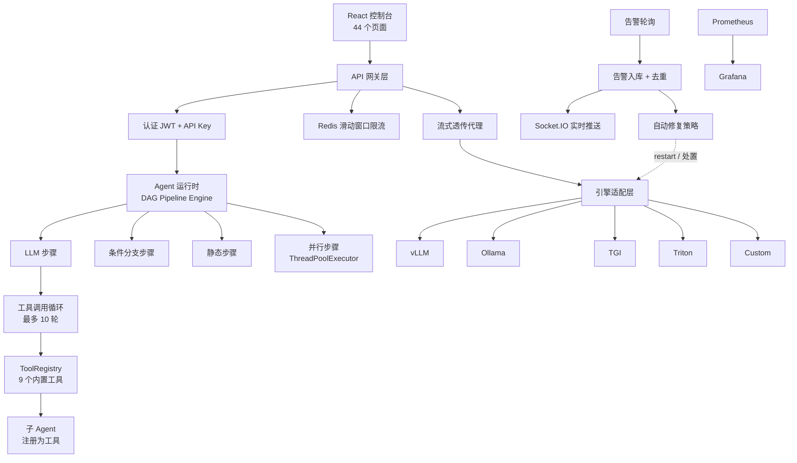

# AI 模型统一管理与智能运维平台（MMS）

> 面向单机 GPU 环境的一站式大模型/小模型部署、统一 API 网关与多 Agent 自动化运维平台。
>
> **规模**：后端 2.9 万行 Python（172 文件 / 28 张表 / 159 个接口）、前端 3.2 万行 TypeScript（44 个页面）
>
> **技术栈**：Python · FastAPI · SQLAlchemy 2.0 · PostgreSQL · Redis · Docker · Prometheus · Grafana · Socket.IO · React 18 · TypeScript

---

## 一、要解决什么问题

单机 GPU 环境跑多个模型时，痛点是**散**：

| 痛点 | 表现 |
|---|---|
| **部署散** | 每个模型一套启动命令、一套端口、一套参数，靠手敲 `docker run` |
| **协议散** | vLLM / Ollama / TGI / Triton 各家的启动参数与 API 形状都不同 |
| **计量散** | 哪个模型被调了多少次、烧了多少 token，没人知道 |
| **运维散** | 容器挂了要人发现、人登录、人重启 |

这个平台把四件事收成一层：**统一部署、统一网关、统一计量、统一运维**。

---

## 二、整体架构



---

## 三、关键设计

### 1. Agent 运行时：自研 DAG 流水线执行引擎

没有套现成框架，从零实现了一套流水线引擎。原因是需求里有两条现成方案不好满足：

- **图合法性要事前校验** —— 用户在可视化界面拖出来的编排图，得在**提交时**就发现成环，
  而不是跑起来才死循环
- **进度事件要分级透出** —— 前端要看到"这一步在调 LLM""这一步在跑工具"，
  而不是一个黑盒 loading

实现要点：

**① DFS 环检测（带路径回溯）。** 标准的三色标记（`visited` + 递归栈 `rec_stack`），
检测到环时把**环路路径**一起带出来 —— 报错信息直接告诉用户"你连成了 A → B → C → A"，
而不是只说一句"检测到环路"。

**② 四类步骤节点。**

| 类型 | 作用 |
|---|---|
| `LLMStep` | 调用模型，支持 `output_key` 从 JSON 结果里取字段 |
| `ConditionStep` | 按前序步骤的输出做分支路由（`eq` / `neq` / `contains` / `not_contains`） |
| `StaticStep` | 渲染一段模板文本，不调模型 |
| `ParallelStep` | 子步骤用 `ThreadPoolExecutor` 并发执行 |

**③ 模板上下文串联。** 节点之间用 `{{user_input}}`、`{{history}}`、`{{step_id.output}}`
这样的模板变量传递数据 —— 用户在前端写 prompt 时直接引用前序节点产物，不需要写代码。

**④ 终态节点流式输出。** 非终态步骤用非流式调用拿完整结果（因为下游要用），
**只有终态步骤走流式**，逐 chunk 推 `delta` 事件。这样既保证了中间结果的可用性，
又让用户看到逐字生成。

**⑤ 贯穿 `max_steps` 防护**（默认 50 步），防止配置失误导致的无限推进。

### 2. Function Calling：多轮工具调用循环

实现了 OpenAI 风格的工具调用循环，**纯标准库 `urllib` 实现，不依赖任何 SDK**：

- 模型返回 `tool_calls` → 执行工具 → 结果以 `role: "tool"` 回灌 → 进入下一轮
- **迭代上限 10 轮**，超限返回明确提示而非静默卡死
- **四类进度回调**：`thinking` / `tool_call` / `tool_result` / `generating`，
  每一步都通过 SSE 推到前端 —— 用户能看到 Agent 在"想什么、调了什么、拿到什么"
- **usage 跨轮累加** —— 多轮调用的 token 计数要累加而非取最后一次，否则严重少算

**ToolRegistry** 统一管理工具，暴露为标准 tool schema。9 个内置工具：

`run_command` · `glob` · `grep` · `read_file` · `write_file` · `web_fetch` · `web_search` · `todo` · `ask_question`

### 3. 多 Agent 协作：把子 Agent 注册成工具

子 Agent 通过 `register_sub_agents()` 动态注册为**普通工具**，于是：

> **"调用另一个 Agent"和"调用一个函数"，在编排层没有区别。**

这样多智能体协作与任务分解**不需要引入额外的调度层** —— 复用已有的工具调用循环就够了。
这是刻意的设计取舍：**能用既有抽象解决的问题，就不新增概念**。

### 4. 模型部署编排：引擎适配器模式

不同推理引擎的启动参数、健康检查方式、API 形状都不同。用适配器模式统一：

```python
class BaseEngine:
    def build_command(...)      # 生成 docker run 命令
    def build_payload(...)      # 构造推理请求体
    def parse_response(...)     # 解析响应，统一出 (text, prompt_tokens, completion_tokens)
    def detect_process(...)     # 进程级健康检查
```

五种引擎实现：`vLLM` · `Ollama` · `TGI` · `Triton` · `Custom`

**两个值得说的细节：**

- **进程级健康检查**：只看容器存活不够 —— 容器在跑但进程僵死，服务一样不可用。
  所以用 `docker top` 的输出判断推理进程是否真的活着。
- **自动生成 `docker run` 命令**：按引擎类型拼装 GPU 直通、端口映射、
  `max-model-len` 等参数，并做**端口/容器资源记账**，避免端口冲突与容器泄漏。

### 5. 统一网关：认证、限流、Token 计量

**双认证**：JWT（控制台）+ API Key（对外调用），API Key 用 **Fernet 对称加密**存储。
按部署目标做**流式透传代理**。

**限流**：Redis 有序集合实现滑动窗口。

```
Key   = rl:{api_key_id}
Score = 请求时间戳（毫秒）
```

每次请求先清理 60s 窗口外的旧条目，再计数判断 —— 相比固定窗口，
滑动窗口不会在窗口边界出现"双倍放行"。

**Token 计量**两个口径互相兜底：

| 口径 | 实现 | 特点 |
|---|---|---|
| 精确 | 流式调用带 `stream_options.include_usage`，末尾 usage chunk 取真实值；非流式走 `tiktoken(cl100k_base)` | 准，但依赖上游支持 |
| 估算 | 字符级（约 3 字符/token） | 上游不给 usage 时兜底 |

同一套编码器还用于**会话历史截断** —— 长对话超出 context window 时按 token 预算裁剪。

### 6. 告警与自愈：监控 → 分析 → 处置

- **轮询检测**：定时检查 Docker 容器与服务器指标
- **告警入库 + 去重**：同一条告警反复触发会产生重复工单把人淹掉，所以做去重
- **实时推送**：Socket.IO 下发到控制台
- **自动修复**：解析告警标题定位容器与告警类型（Agent / 大模型 / 小模型 / 容器），
  按类型匹配处置动作（如"容器异常退出"→ 重启），形成处置闭环

**权限体系**：基于依赖注入的 RBAC，角色 / 权限 / 角色-权限三表建模，鉴权结果 Redis 缓存。
密码 bcrypt 加盐存储。

---

## 四、规模与技术栈

| 层 | 选型 |
|---|---|
| 后端 | Python 3.10 · FastAPI · SQLAlchemy 2.0 · Pydantic |
| 前端 | React 18 · TypeScript · Vite · Tailwind · Zustand · React Query |
| 数据库 | PostgreSQL 16（28 张表） |
| 缓存 / 限流 | Redis 7.4 |
| 容器 | Docker · Docker Compose |
| 推理引擎 | vLLM · Ollama · TGI · Triton |
| 监控 | Prometheus · Grafana |
| 实时通道 | Socket.IO（Web 终端 / 告警推送） |

---

## 五、我负责的部分

从架构设计到前后端实现的完整交付，覆盖四个模块：

**Agent 子系统** · **模型部署编排** · **统一网关与计量** · **告警与自愈**

---

> ⚠️ 本仓库为个人技术总结，**不含业务代码与公司内部数据**。
